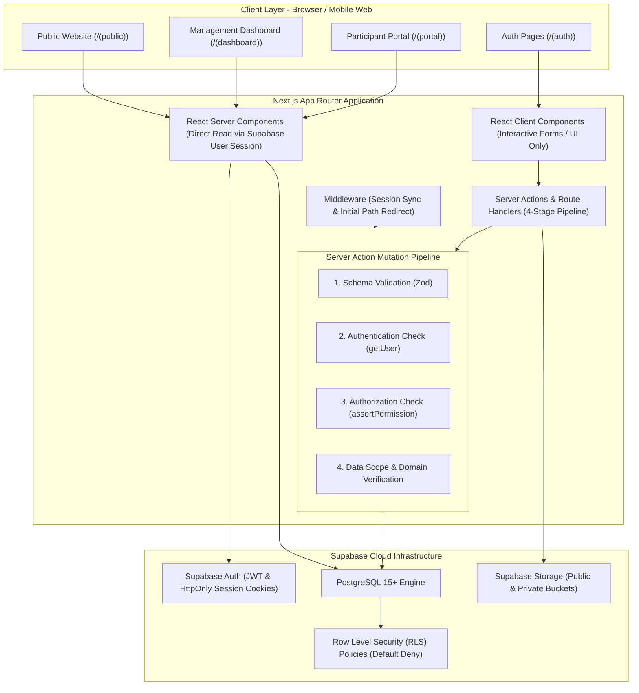
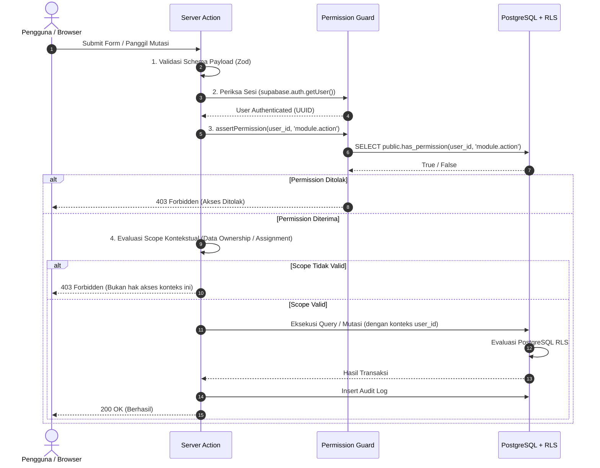
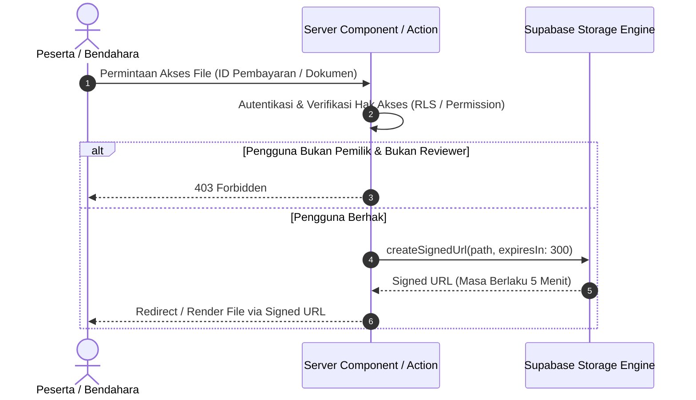

# System Architecture & Technical Guidelines (Revised)
## SAPA Ayah Digital Platform
**Organization:** Yayasan Sahabat Pembelajar Ayah (SAPA) Ayah  
**Document Version:** 1.1 (Post-Review Alignment)  
**Stack:** Next.js App Router, TypeScript, Tailwind CSS, shadcn/ui, Supabase (PostgreSQL, Auth, Storage, RLS)  
**Date:** November 2026  

---

## 1. Arsitektur Tingkat Tinggi & Prinsip Keamanan Sistem

SAPA Ayah Digital Platform menggunakan arsitektur monolitik modern dengan Next.js App Router yang terhubung ke Backend-as-a-Service Supabase. Keamanan dirancang secara berlapis (*defense-in-depth*):



### 1.1 Prinsip Keamanan & Akses Data
1. **Server Components Menggunakan Sesi Pengguna:**
   - Server Components mengambil data menggunakan Supabase Server Client yang membawa sesi pengguna aktif (`auth.uid()`).
   - Query dieksekusi di bawah konteks pengguna sehingga PostgreSQL Row Level Security (RLS) **tetap aktif dan berlaku** untuk memfilter baris data yang berhak diakses.
2. **Pembatasan Ketat Service Role Key:**
   - `SUPABASE_SERVICE_ROLE_KEY` **hanya boleh digunakan** pada konteks server-side tertentu yang diotorisasi secara eksplisit (seperti pembersihan token kadaluarsa, migrasi terjadwal, atau bypass RLS untuk penulisan audit log tak terhapuskan).
   - Penggunaan Service Role Key untuk operasi bisnis sehari-hari **dilarang keras**.
3. **Middleware Bukan Satu-Satunya Lapisan Pertahanan:**
   - Next.js Middleware hanya berfungsi untuk *session synchronization* (memperbarui cookie sesi) dan *optimistic UX redirect* (mengalihkan pengguna yang belum login ke `/login`).
   - Middleware tidak boleh dianggap sebagai perimeter keamanan mutlak. Validasi autentikasi dan otorisasi hak akses wajib ditegakkan kembali di setiap Server Component, Server Action, dan Route Handler.
4. **Pipa 4 Tahap Mutasi (Server Actions & Route Handlers):**
   Setiap Server Action dan Route Handler wajib melalui 4 tahapan evaluasi sebelum memanipulasi database:
   - **Tahap 1 (Validasi Skema):** Memvalidasi seluruh payload masukan menggunakan schema Zod.
   - **Tahap 2 (Autentikasi):** Memverifikasi identitas pengguna (`supabase.auth.getUser()`).
   - **Tahap 3 (Otorisasi Permission):** Memeriksa apakah pengguna memiliki hak akses yang dipersyaratkan (`assertPermission(code)`).
   - **Tahap 4 (Pemeriksaan Cakupan Data / Scope):** Memeriksa batasan kontekstual (misal: apakah fasilitator ditugaskan pada sesi ini, apakah peserta hanya mengubah data pendaftaran miliknya, apakah bendahara tidak memverifikasi bukti miliknya sendiri).

---

## 2. Struktur Proyek & Isolasi Rute (Route Groups)

Struktur Next.js menggunakan Route Groups untuk mencegah tabrakan URL (*route collision*):

```
src/app/
├── layout.tsx                 # Root HTML & Global Providers
├── globals.css                # CSS Variables & Tailwind Tokens
├── (public)/                  # Route Group Publik (Root Path: /)
│   ├── layout.tsx             # Navbar Publik & Footer
│   ├── page.tsx               # / (Beranda)
│   ├── tentang/page.tsx       # /tentang
│   ├── program/
│   │   ├── page.tsx           # /program
│   │   └── [slug]/page.tsx    # /program/:slug
│   ├── kegiatan/
│   │   ├── page.tsx           # /kegiatan
│   │   └── [slug]/page.tsx    # /kegiatan/:slug
│   ├── daftar/[batchSlug]/    # /daftar/:batchSlug
│   └── kontak/page.tsx        # /kontak
├── (auth)/                    # Route Group Autentikasi
│   ├── layout.tsx             # Layout Terpusat Kartu Auth
│   ├── login/page.tsx         # /login
│   ├── register/page.tsx      # /register
│   └── lupa-password/page.tsx # /lupa-password
├── (dashboard)/               # Route Group Panel Pengurus
│   ├── layout.tsx             # Sidebar Admin, Topbar & Breadcrumb
│   └── dashboard/             # Awalan URL: /dashboard/*
│       ├── page.tsx           # /dashboard
│       ├── organisasi/page.tsx# /dashboard/organisasi
│       ├── program/page.tsx   # /dashboard/program
│       ├── kegiatan/page.tsx  # /dashboard/kegiatan
│       ├── peserta/page.tsx   # /dashboard/peserta
│       ├── pembayaran/page.tsx# /dashboard/pembayaran
│       ├── tugas/page.tsx     # /dashboard/tugas
│       ├── target/page.tsx    # /dashboard/target
│       ├── laporan-jumat/     # /dashboard/laporan-jumat
│       └── pengaturan/page.tsx# /dashboard/pengaturan
└── (portal)/                  # Route Group Portal Peserta
    ├── layout.tsx             # Sidebar Portal & Topbar Peserta
    └── portal/                # Awalan URL: /portal/*
        ├── page.tsx           # /portal
        ├── profil/page.tsx    # /portal/profil
        ├── program-saya/      # /portal/program-saya
        ├── pembayaran/page.tsx# /portal/pembayaran
        ├── jadwal/page.tsx    # /portal/jadwal
        ├── materi/page.tsx    # /portal/materi
        ├── absensi/page.tsx   # /portal/absensi
        └── sertifikat/page.tsx# /portal/sertifikat
```

> **Catatan Pencegahan Tabrakan:**  
> Berkas `src/app/page.tsx` di tingkat root ditiadakan untuk menghindari benturan rute dengan `src/app/(public)/page.tsx` yang menangani path root `/`.

---

## 3. Alur Autentikasi, Otorisasi, & Akses File Privat

### 3.1 Alur Autentikasi (Authentication Flow)
1. Pengguna mengirimkan email dan password ke Server Action `loginAction`.
2. Server Action memvalidasi input dengan Zod dan memanggil `supabase.auth.signInWithPassword()`.
3. Supabase Auth menerbitkan access token (JWT) dan refresh token yang disimpan dalam HttpOnly, Secure, SameSite Cookie di browser via `@supabase/ssr`.
4. Untuk setiap permintaan halaman, Supabase Server Client memvalidasi sesi dengan `getUser()` (bukan sekadar membaca payload cookie tanpa verifikasi) untuk memastikan token belum dicabut.

### 3.2 Alur Evaluasi Otorisasi (Authorization Pipeline)


### 3.3 Alur Akses File Privat (Private File Access Flow)
Seluruh berkas sensitif (bukti transfer, dokumen internal, materi hak cipta) disimpan dalam bucket privat:



---

## 4. Konfigurasi Lingkungan Aman (.env.example)

Seluruh konfigurasi lingkungan menggunakan placeholder anonim dan aman:

```bash
# ==============================================================================
# SAPA Ayah Digital Platform - Environment Configuration Template
# Salin file ini menjadi .env.local untuk konfigurasi lokal
# ==============================================================================

# Public Application URLs
NEXT_PUBLIC_SITE_URL=http://localhost:3000

# Supabase Public Keys (Aman untuk Browser & Client Components)
NEXT_PUBLIC_SUPABASE_URL=https://your-project-id.supabase.co
NEXT_PUBLIC_SUPABASE_ANON_KEY=eyJhbGciOiJIUzI1NiIsInR5cCI6IkpXVCJ9.example_anon_key

# Supabase Server-Only Secret (DILARANG KERAS menggunakan prefix NEXT_PUBLIC_)
# HANYA DIGUNAKAN DI SERVER-SIDE untuk operasi administratif yang diotorisasi
SUPABASE_SERVICE_ROLE_KEY=eyJhbGciOiJIUzI1NiIsInR5cCI6IkpXVCJ9.example_service_role_key
```
