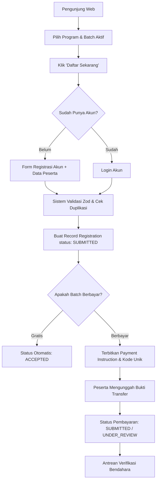

# Business Process & Operational Mapping
## SAPA Ayah Digital Platform
**Organization:** Yayasan Sahabat Pembelajar Ayah (SAPA) Ayah  
**Document Version:** 1.0  
**Status:** Approved for Implementation Planning  
**Date:** November 2026  

---

## 1. Ikhtisar Alur Bisnis Organisasi

SAPA Ayah adalah yayasan pembelajar keluarga yang menitikberatkan pada penguatan peran ayah. Sistem digital SAPA Ayah dirancang untuk menjembatani operasional internal yayasan yang gesit, kegiatan edukatif berjenjang, dan pendataan peserta yang tertib serta transparan.

---

## 2. Alur Pendaftaran Program (Registration Workflow)

### 2.1 Alur Pendaftaran Mandiri Online (Self-Service)


### 2.2 Alur Pendaftaran Manual oleh Admin (Admin-Assisted)
Alur ini digunakan untuk mengakomodasi pendaftar offline, via WhatsApp resmi, atau pendaftaran kolektif/kemitraan:
1. **Pencarian Peserta (Deduplikasi):** Admin mencari data peserta berdasarkan Email atau Nomor WhatsApp di panel `/dashboard/peserta`.
2. **Penentuan Profil:**
   - Jika peserta sudah ada: Admin memilih profil peserta yang ada (`participant_id`).
   - Jika peserta baru: Admin membuat profil peserta baru.
3. **Pembuatan Pendaftaran:** Admin menautkan peserta ke `batch_id` yang dituju, mengisi `registration_source = 'admin_manual'` atau `'whatsapp'`.
4. **Penanganan Akun:** Jika peserta belum memiliki akun auth, sistem menandai perlunya aktivasi atau mengirimkan email undangan aktivasi akun.
5. **Penanganan Pembayaran:** Mengikuti alur verifikasi bukti pembayaran manual atau bypass jika ada otorisasi beasiswa/khusus yang tercatat pada audit trail.

---

## 3. Alur Verifikasi Pembayaran Transfer Manual (Payment Workflow)

### 3.1 Siklus Status Pembayaran
```
[PENDING] ────(Peserta upload bukti)────> [SUBMITTED]
                                             │
                                             ▼
                                     [UNDER_REVIEW]
                                       │        │
                     (Petugas Setuju)  │        │  (Petugas Tolak)
                                       ▼        ▼
                                  [VERIFIED]  [REJECTED]
                                       │        │
                                  (Akses Aktif) └──(Upload ulang bukti)──> [SUBMITTED]
```

### 3.2 Aturan Ketat Verifikasi Pembayaran
1. **Tidak Ada Status Otomatis:** File bukti yang diunggah ke storage **TIDAK PERNAH** secara otomatis mengubah status menjadi `VERIFIED`. Status hanya berpindah ke `SUBMITTED` / `UNDER_REVIEW`.
2. **Pemisahan Kewenangan (Segregation of Duties):** Verifikasi hanya dapat dilakukan oleh akun dengan hak akses `payments.verify` (Bendahara atau Finance Reviewer).
3. **Catatan Penolakan Wajib:** Jika bukti pembayaran ditolak (`REJECTED`), petugas wajib mengisi kolom catatan alasan (misal: "Nominal tidak sesuai", "Bukti transfer buram/tidak terbaca", "Rekening tujuan keliru").
4. **Pemberitahuan Status:** Perubahan status memicu pembaruan pada portal peserta dan email notifikasi sistem.

---

## 4. Ritme Operasional Organisasi (Operational Rhythms)

Struktur organisasi SAPA Ayah bekerja dalam ritme terstruktur yang didukung oleh fitur dashboard:

| Frekuensi | Forum / Aktivitas | Penanggung Jawab | Dukungan Sistem Digital |
| :--- | :--- | :--- | :--- |
| **Setiap Jumat** | **Laporan Mingguan Tiga Baris**<br>1. Sudah apa?<br>2. Akan apa?<br>3. Apa kendalanya? | Seluruh Pengurus & Personel Aktif | Form Laporan Jumat di dashboard pribadi; validasi 3 field wajib; riwayat per periode. |
| **Mingguan** | **Rekap Progres Mingguan** | Humas (PR) | Dashboard monitoring status kepatuhan pengisian laporan; kompilasi laporan mingguan yayasan. |
| **Dua Mingguan** | **Rapat Koordinasi Evaluasi (30 Menit)** | Ketua Yayasan | Modul notula rapat, penelusuran keputusan, dan penetapan PIC tindak lanjut tugas. |
| **Tiga Bulanan** | **Tinjauan Target & Rotasi Peran** | Ketua bersama seluruh pengurus | Rekapitulasi target KPI triwulanan; pengalihan tanggung jawab peran kegiatan. |

---

## 5. Target Bulanan Pengurus (Monthly KPIs)

Sesuai dokumen sumber, target kinerja bulanan dicatat dalam sistem sebagai target dinamis (bukan hardcoded):

1. **Ketua (Dr. Fahrurroji Firman, M.Pd.I):**
   - 1 Modul materi selesai disusun/ditinjau.
   - 2 Rapat koordinasi online terlaksana.
   - *Target ketiga:* "2 episode podcast dihadiri" (*Menunggu konfirmasi pemilik proyek mengenai redaksi definitif*).
2. **Public Relations / Humas (Rizqi):**
   - 1 Narasumber atau mitra strategis baru.
   - 1 Publikasi liputan lewat media atau influencer keluarga.
   - 4x Rangkuman progres mingguan (setiap Jumat).
3. **Admin & Editor (Yusuf):**
   - 2 Video rekaman YouTube selesai diedit dan siap tayang.
   - Respon pesan masuk / DM media sosial maksimal 24 jam.
   - Sertifikat peserta terkirim H+3 pasca-selesainya acara.
4. **Kreator Konten (Yopi):**
   - 2 Episode podcast YouTube selesai diproduksi/direkam.
   - 10 Konten video pendek (Reels/TikTok/Shorts) terunggah.
   - Poster promosi setiap kegiatan terbit selambat-lambatnya H-14.
5. **Bendahara (Ganjar):**
   - 1 Laporan keuangan konsolidasian akhir bulan.
   - 2 Kunjungan / audiensi calon mitra pendukung.
   - Pengiriman pengingat jadwal peserta pada H-1 sebelum setiap sesi kelas.

---

## 6. Roadmap Operasional Program 6 Bulan Pertama

Berdasarkan dokumen perencanaan program yayasan:

| Periode | Program Operasional | Model Biaya | Sasaran Utama |
| :--- | :--- | :--- | :--- |
| **Bulan 1** | Podcast YouTube (Konsep Baru) | Gratis (Public) | Membangun kepercayaan, kesadaran, dan menjaring audiens ayah muda. |
| **Bulan 1–2** | Webinar *"Ayah, Arahnya ke Mana?"* | Gratis (Public) | Peluncuran resmi dan pengumpulan basis data pendaftar ayah muda. |
| **Bulan 3** | **Kelas Menjadi Ayah** | Berbayar | Pendampingan intensif bagi ayah baru di masa awal pengasuhan. |
| **Bulan 4–5** | Webinar Pranikah | Gratis (Public) | Menjangkau calon ayah dan pasangan muda. |
| **Bulan 6** | **Kelas Pranikah** | Berbayar | Pembekalan kesiapan mental, spiritual, dan finansial sebelum menikah. |
| **Pasca-Kelas** | Grup Alumni Komunitas | Gratis (Eksklusif) | Komunitas alumni saling menguatkan dan berjejaring jangka panjang. |

*Catatan: Tanggal kalender pasti untuk Bulan 1, jumlah pertemuan per kelas, dan harga tiket kelas berbayar akan dikonfigurasi melalui modul pengaturan master data sistem.*

