# Database Design & Entity Relationship Architecture (Revised)
## SAPA Ayah Digital Platform
**Organization:** Yayasan Sahabat Pembelajar Ayah (SAPA) Ayah  
**Document Version:** 1.1 (Post-Review Alignment)  
**Database Engine:** PostgreSQL 15+ (Supabase Managed Engine)  
**Date:** November 2026  

---

## 1. Prinsip Pemisahan Domain Data & Relasi Entitas

Rancangan database SAPA Ayah dibangun di atas pemisahan batas entitas yang tegas untuk mencerminkan dinamika organisasi nyata tanpa ketergantungan kaku:

### 1.1 Pemisahan Konsep Identitas & Keanggotaan
1. **`auth.users` vs `profiles`:**  
   - `auth.users` adalah akun otentikasi Supabase (email, password hash, status verifikasi email).  
   - `profiles` adalah informasi personal dan sosial pengguna (nama lengkap, nama panggilan, nomor WhatsApp, avatar, status akun).
2. **`profiles` vs `participants` (Peserta Program):**  
   - Seorang pengguna tidak harus memiliki akun login saat pertama kali didaftarkan oleh admin (misal pendaftaran via WhatsApp).  
   - `participants` menyimpan data pendaftar program keayahaan. Kolom `profile_id` bernilai opsional (*nullable*).  
   - **Peserta program TIDAK OTOMATIS menjadi anggota yayasan.**
3. **`memberships` (Keanggotaan Yayasan) vs `alumni_profiles`:**  
   - `memberships` mencatat status formal keanggotaan yayasan (*calon anggota*, *anggota aktif*, *kehormatan*, *non-aktif*).  
   - `alumni_profiles` mencatat peserta yang telah menyelesaikan program tertentu dan tergabung dalam jejaring komunitas alumni. Status alumni tidak otomatis memberikan hak keanggotaan struktural yayasan.
4. **`positions` vs `personnel_assignments` vs `activity_assignments`:**  
   - `positions` adalah jabatan dalam struktur organisasi (misal: Ketua, Humas, Bendahara, Staff).  
   - `personnel_assignments` adalah riwayat penetapan masa jabatan seseorang pada suatu posisi struktural.  
   - `activity_assignments` adalah penugasan kepanitiaan per kegiatan/batch (misal: PIC Kegiatan, Moderator, Fasilitator, Logistik). **Penugasan kegiatan bersifat fleksibel/bergilir dan TIDAK BERGANTUNG pada jabatan struktural permanen.**
5. **`user_roles`:**  
   - Hak akses sistem (Super Admin, Finance Reviewer, Admin Peserta, dll.) diberikan melalui relasi `user_roles`, terpisah dari jabatan struktural.

---

## 2. Diagram Relasi Entitas Lengkap (Comprehensive Mermaid ERD)

Semua entitas yang ada di diagram ini memiliki definisi detail dalam kamus data:

```mermaid
erDiagram
    AUTH_USERS ||--|| PROFILES : "has profile"
    PROFILES ||--o{ USER_ROLES : "assigned roles"
    ROLES ||--o{ USER_ROLES : "in role"
    ROLES ||--o{ ROLE_PERMISSIONS : "contains"
    PERMISSIONS ||--o{ ROLE_PERMISSIONS : "assigned to"
    
    ORGANIZATIONAL_UNITS ||--o{ POSITIONS : "has positions"
    POSITIONS ||--o{ POSITIONS : "parent position"
    POSITIONS ||--o{ JOB_DESCRIPTIONS : "has jobdesks"
    PROFILES ||--o{ PERSONNEL_ASSIGNMENTS : "structural role"
    POSITIONS ||--o{ PERSONNEL_ASSIGNMENTS : "filled by"
    
    PROFILES ||--o{ MEMBERSHIPS : "holds membership"
    MEMBERSHIPS ||--o{ MEMBERSHIP_STATUS_HISTORY : "tracks status"
    
    PROGRAMS ||--o{ PROGRAM_BATCHES : "has batches"
    PROGRAM_BATCHES ||--o{ ACTIVITIES : "conducts"
    ACTIVITIES ||--o{ ACTIVITY_ASSIGNMENTS : "assigns crew"
    PROFILES ||--o{ ACTIVITY_ASSIGNMENTS : "assigned to activity"
    
    PROFILES ||--o| PARTICIPANTS : "linked to profile"
    PARTICIPANTS ||--o{ REGISTRATIONS : "submits registration"
    PROGRAM_BATCHES ||--o{ REGISTRATIONS : "receives registration"
    
    REGISTRATIONS ||--o{ PAYMENTS : "billed via"
    PAYMENT_INSTRUCTIONS ||--o{ PAYMENTS : "uses account"
    PAYMENTS ||--o{ PAYMENT_PROOF_SUBMISSIONS : "has proof attempts"
    PAYMENT_PROOF_SUBMISSIONS ||--o{ PAYMENT_VERIFICATIONS : "reviewed in"
    PROFILES ||--o{ PAYMENT_VERIFICATIONS : "reviewer"
    
    PROGRAM_BATCHES ||--o{ CLASS_SESSIONS : "schedules sessions"
    PROFILES ||--o{ CLASS_SESSIONS : "facilitated by"
    CLASS_SESSIONS ||--o{ ATTENDANCE_RECORDS : "records presence"
    PARTICIPANTS ||--o{ ATTENDANCE_RECORDS : "attends"
    
    PROGRAM_BATCHES ||--o{ LEARNING_MATERIALS : "contains materials"
    PROFILES ||--o{ LEARNING_MATERIALS : "uploaded by"
    
    PROGRAM_BATCHES ||--o{ CERTIFICATES : "issues for batch"
    PARTICIPANTS ||--o{ CERTIFICATES : "awarded to"
    PROFILES ||--o{ CERTIFICATES : "signed by"
    
    TARGET_PERIODS ||--o{ PERFORMANCE_TARGETS : "spans period"
    POSITIONS ||--o{ PERFORMANCE_TARGETS : "target for position"
    PROFILES ||--o{ PERFORMANCE_TARGETS : "assigned target"
    PERFORMANCE_TARGETS ||--o{ PROGRESS_UPDATES : "logs updates"
    PROFILES ||--o{ PROGRESS_UPDATES : "updated by"
    
    PERFORMANCE_TARGETS ||--o{ TASKS : "derived from"
    TASKS ||--o{ TASK_ASSIGNMENTS : "assigned to"
    PROFILES ||--o{ TASK_ASSIGNMENTS : "task assignee"
    TASKS ||--o{ TASK_UPDATES : "progress logs"
    PROFILES ||--o{ TASK_UPDATES : "logged by"
    
    PROFILES ||--o{ WEEKLY_REPORTS : "submits Friday report"
    
    PARTICIPANTS ||--o| ALUMNI_PROFILES : "becomes alumni"
    ALUMNI_PROFILES ||--o{ COMMUNITY_MEMBERSHIPS : "joins community"
    
    PROFILES ||--o{ AUDIT_LOGS : "performs action"
```

---

## 3. Kamus Data & Spesifikasi Entitas Lengkap

### 3.1 Domain Akun, Identitas & RBAC
- **`profiles`**
  - `id`: UUID PRIMARY KEY REFERENCES `auth.users(id)` ON DELETE CASCADE
  - `full_name`: VARCHAR(255) NOT NULL
  - `display_name`: VARCHAR(100)
  - `phone`: VARCHAR(25) (Format E.164, misal: `+628...`)
  - `avatar_path`: TEXT (Path Supabase Storage)
  - `account_status`: VARCHAR(20) NOT NULL DEFAULT 'active' CHECK (`account_status` IN ('active', 'suspended', 'inactive'))
  - `created_at`, `updated_at`: TIMESTAMPTZ NOT NULL DEFAULT now()
- **`roles`**
  - `id`: UUID PRIMARY KEY DEFAULT gen_random_uuid()
  - `code`: VARCHAR(50) UNIQUE NOT NULL (Contoh: `super_admin`, `ketua`, `pengurus`, `bendahara`, `admin_peserta`, `kreator_konten`, `fasilitator`, `relawan`, `peserta`, `alumni`)
  - `name`: VARCHAR(100) NOT NULL
  - `description`: TEXT
  - `is_system_role`: BOOLEAN DEFAULT true
  - `created_at`: TIMESTAMPTZ NOT NULL DEFAULT now()
- **`permissions`**
  - `id`: UUID PRIMARY KEY DEFAULT gen_random_uuid()
  - `code`: VARCHAR(100) UNIQUE NOT NULL (Format: `<module>.<action>`, misal: `payments.verify`)
  - `module`: VARCHAR(50) NOT NULL
  - `action`: VARCHAR(50) NOT NULL
  - `description`: TEXT
  - `created_at`: TIMESTAMPTZ NOT NULL DEFAULT now()
- **`role_permissions`**
  - `role_id`: UUID REFERENCES `roles(id)` ON DELETE CASCADE
  - `permission_id`: UUID REFERENCES `permissions(id)` ON DELETE CASCADE
  - PRIMARY KEY (`role_id`, `permission_id`)
- **`user_roles`**
  - `id`: UUID PRIMARY KEY DEFAULT gen_random_uuid()
  - `user_id`: UUID NOT NULL REFERENCES `profiles(id)` ON DELETE CASCADE
  - `role_id`: UUID NOT NULL REFERENCES `roles(id)` ON DELETE CASCADE
  - `assigned_by`: UUID REFERENCES `profiles(id)`
  - `assigned_at`: TIMESTAMPTZ NOT NULL DEFAULT now()
  - `expires_at`: TIMESTAMPTZ
  - UNIQUE (`user_id`, `role_id`)

### 3.2 Domain Organisasi & Penugasan
- **`organizational_units`**
  - `id`: UUID PRIMARY KEY DEFAULT gen_random_uuid()
  - `name`: VARCHAR(100) NOT NULL (Contoh: "Pengurus Harian", "Divisi Program & Pembelajaran", "Divisi Media & Konten")
  - `description`: TEXT
  - `created_at`, `updated_at`: TIMESTAMPTZ NOT NULL DEFAULT now()
- **`positions`**
  - `id`: UUID PRIMARY KEY DEFAULT gen_random_uuid()
  - `unit_id`: UUID NOT NULL REFERENCES `organizational_units(id)` ON DELETE RESTRICT
  - `title`: VARCHAR(100) NOT NULL (Contoh: "Ketua", "Humas", "Bendahara", "Admin & Editor", "Kreator Konten")
  - `parent_position_id`: UUID REFERENCES `positions(id)`
  - `is_active`: BOOLEAN DEFAULT true
  - `created_at`, `updated_at`: TIMESTAMPTZ NOT NULL DEFAULT now()
- **`personnel_assignments`**
  - `id`: UUID PRIMARY KEY DEFAULT gen_random_uuid()
  - `profile_id`: UUID NOT NULL REFERENCES `profiles(id)` ON DELETE RESTRICT
  - `position_id`: UUID NOT NULL REFERENCES `positions(id)` ON DELETE RESTRICT
  - `start_date`: DATE NOT NULL
  - `end_date`: DATE
  - `assignment_status`: VARCHAR(20) DEFAULT 'active' CHECK (`assignment_status` IN ('active', 'completed', 'transferred'))
  - `created_at`, `updated_at`: TIMESTAMPTZ NOT NULL DEFAULT now()
- **`job_descriptions`**
  - `id`: UUID PRIMARY KEY DEFAULT gen_random_uuid()
  - `position_id`: UUID NOT NULL REFERENCES `positions(id)` ON DELETE CASCADE
  - `responsibility`: TEXT NOT NULL
  - `performance_indicator`: TEXT
  - `created_at`, `updated_at`: TIMESTAMPTZ NOT NULL DEFAULT now()
- **`memberships`**
  - `id`: UUID PRIMARY KEY DEFAULT gen_random_uuid()
  - `profile_id`: UUID NOT NULL REFERENCES `profiles(id)` ON DELETE CASCADE
  - `membership_number`: VARCHAR(50) UNIQUE
  - `type`: VARCHAR(30) NOT NULL DEFAULT 'regular' CHECK (`type` IN ('candidate', 'regular', 'honorary', 'inactive'))
  - `joined_date`: DATE NOT NULL DEFAULT CURRENT_DATE
  - `created_at`, `updated_at`: TIMESTAMPTZ NOT NULL DEFAULT now()
- **`membership_status_history`**
  - `id`: UUID PRIMARY KEY DEFAULT gen_random_uuid()
  - `membership_id`: UUID NOT NULL REFERENCES `memberships(id)` ON DELETE CASCADE
  - `previous_status`: VARCHAR(30)
  - `new_status`: VARCHAR(30) NOT NULL
  - `reason`: TEXT
  - `changed_by`: UUID REFERENCES `profiles(id)`
  - `created_at`: TIMESTAMPTZ NOT NULL DEFAULT now()

### 3.3 Domain Program, Batch, Kegiatan & Penugasan Bergilir
- **`programs`**
  - `id`: UUID PRIMARY KEY DEFAULT gen_random_uuid()
  - `name`: VARCHAR(150) NOT NULL (Contoh: "SAPA Start", "SAPA Grow: Kelas Menjadi Ayah", "SAPA Talk")
  - `slug`: VARCHAR(150) UNIQUE NOT NULL
  - `tagline`: VARCHAR(255)
  - `description`: TEXT
  - `program_type`: VARCHAR(50) NOT NULL CHECK (`program_type` IN ('journey', 'class', 'webinar', 'camp', 'talk', 'stories'))
  - `visibility`: VARCHAR(20) DEFAULT 'draft' CHECK (`visibility` IN ('draft', 'published', 'archived'))
  - `created_at`, `updated_at`: TIMESTAMPTZ NOT NULL DEFAULT now()
- **`program_batches`**
  - `id`: UUID PRIMARY KEY DEFAULT gen_random_uuid()
  - `program_id`: UUID NOT NULL REFERENCES `programs(id)` ON DELETE RESTRICT
  - `batch_number`: INT NOT NULL
  - `name`: VARCHAR(150) NOT NULL
  - `slug`: VARCHAR(150) UNIQUE NOT NULL
  - `registration_open_at`: TIMESTAMPTZ NOT NULL
  - `registration_close_at`: TIMESTAMPTZ NOT NULL
  - `start_at`: TIMESTAMPTZ NOT NULL
  - `end_at`: TIMESTAMPTZ NOT NULL
  - `price`: DECIMAL(12, 2) NOT NULL DEFAULT 0.00
  - `capacity`: INT NOT NULL DEFAULT 50
  - `status`: VARCHAR(20) DEFAULT 'draft' CHECK (`status` IN ('draft', 'open', 'in_progress', 'completed', 'cancelled'))
  - `created_at`, `updated_at`: TIMESTAMPTZ NOT NULL DEFAULT now()
- **`activities`**
  - `id`: UUID PRIMARY KEY DEFAULT gen_random_uuid()
  - `batch_id`: UUID REFERENCES `program_batches(id)` ON DELETE CASCADE
  - `title`: VARCHAR(200) NOT NULL
  - `description`: TEXT
  - `activity_type`: VARCHAR(50) NOT NULL CHECK (`activity_type` IN ('webinar', 'class_session', 'recording', 'meeting', 'workshop'))
  - `scheduled_at`: TIMESTAMPTZ NOT NULL
  - `location_or_url`: TEXT
  - `created_at`, `updated_at`: TIMESTAMPTZ NOT NULL DEFAULT now()
- **`activity_assignments` (Penugasan Kegiatan Bergilir)**
  - `id`: UUID PRIMARY KEY DEFAULT gen_random_uuid()
  - `activity_id`: UUID NOT NULL REFERENCES `activities(id)` ON DELETE CASCADE
  - `profile_id`: UUID NOT NULL REFERENCES `profiles(id)` ON DELETE RESTRICT
  - `role_in_activity`: VARCHAR(50) NOT NULL CHECK (`role_in_activity` IN ('pic', 'moderator', 'speaker', 'admin_support', 'content_creator', 'logistics'))
  - `notes`: TEXT
  - `assigned_by`: UUID REFERENCES `profiles(id)`
  - `assigned_at`: TIMESTAMPTZ NOT NULL DEFAULT now()
  - UNIQUE (`activity_id`, `profile_id`, `role_in_activity`)

### 3.4 Domain Peserta & Pendaftaran (Deduplication Mechanism)
- **`participants`**
  - `id`: UUID PRIMARY KEY DEFAULT gen_random_uuid()
  - `profile_id`: UUID REFERENCES `profiles(id)` ON DELETE SET NULL (Nullable untuk peserta non-akun)
  - `full_name`: VARCHAR(255) NOT NULL
  - `normalized_name`: VARCHAR(255) NOT NULL (Uppercase, trimmed untuk pencocokan)
  - `email`: VARCHAR(255) NOT NULL
  - `phone`: VARCHAR(25) NOT NULL (Format E.164 terstandar, misal `+62812...`)
  - `city`: VARCHAR(100)
  - `marital_status`: VARCHAR(50) CHECK (`marital_status` IN ('married_with_children', 'married_no_children', 'engaged', 'single'))
  - `number_of_children`: INT DEFAULT 0
  - `created_at`, `updated_at`: TIMESTAMPTZ NOT NULL DEFAULT now()
  - UNIQUE (`email`)
  - UNIQUE (`phone`)
- **`registrations`**
  - `id`: UUID PRIMARY KEY DEFAULT gen_random_uuid()
  - `participant_id`: UUID NOT NULL REFERENCES `participants(id)` ON DELETE RESTRICT
  - `batch_id`: UUID NOT NULL REFERENCES `program_batches(id)` ON DELETE RESTRICT
  - `registration_source`: VARCHAR(50) DEFAULT 'web_self_service' CHECK (`registration_source` IN ('web_self_service', 'admin_manual', 'whatsapp_offline'))
  - `status`: VARCHAR(20) DEFAULT 'submitted' CHECK (`status` IN ('draft', 'submitted', 'under_review', 'accepted', 'waitlisted', 'cancelled'))
  - `notes`: TEXT
  - `submitted_at`: TIMESTAMPTZ NOT NULL DEFAULT now()
  - `reviewed_by`: UUID REFERENCES `profiles(id)`
  - `created_at`, `updated_at`: TIMESTAMPTZ NOT NULL DEFAULT now()
  - UNIQUE (`participant_id`, `batch_id`)

#### Mekanisme Deteksi Duplikasi Peserta:
1. **Pendaftaran Mandiri:**
   - Sistem melakukan pencarian kandidat peserta berdasarkan: `email = LOWER(input_email)` ATAU `phone = NORMALIZE(input_phone)`.
   - Jika ditemukan profil peserta yang cocok, pendaftaran dikaitkan ke `participant_id` yang sudah ada, mencegah terbentuknya baris ganda.
2. **Pendaftaran Manual Admin:**
   - Antarmuka Admin Peserta menyediakan fitur *autocomplete/lookup* berdasarkan nomor telepon dan email.
   - Jika peserta ditemukan, admin memilih profil tersebut. Jika tidak ditemukan, form pembuatan peserta baru diaktifkan.

### 3.5 Domain Pembayaran Transfer Manual & Histori Verifikasi
- **`payment_instructions`**
  - `id`: UUID PRIMARY KEY DEFAULT gen_random_uuid()
  - `bank_name`: VARCHAR(50) NOT NULL (Misal: "Bank Syariah Indonesia")
  - `account_number`: VARCHAR(50) NOT NULL
  - `account_holder`: VARCHAR(150) NOT NULL
  - `instructions`: TEXT
  - `is_active`: BOOLEAN DEFAULT true
  - `created_at`, `updated_at`: TIMESTAMPTZ NOT NULL DEFAULT now()
- **`payments`**
  - `id`: UUID PRIMARY KEY DEFAULT gen_random_uuid()
  - `registration_id`: UUID NOT NULL REFERENCES `registrations(id)` ON DELETE RESTRICT
  - `instruction_id`: UUID NOT NULL REFERENCES `payment_instructions(id)` ON DELETE RESTRICT
  - `amount_due`: DECIMAL(12, 2) NOT NULL
  - `unique_code`: INT DEFAULT 0
  - `status`: VARCHAR(20) DEFAULT 'pending' CHECK (`status` IN ('pending', 'submitted', 'under_review', 'verified', 'rejected'))
  - `created_at`, `updated_at`: TIMESTAMPTZ NOT NULL DEFAULT now()
- **`payment_proof_submissions` (Histori Pengajuan & Upload Ulang Bukti)**
  - `id`: UUID PRIMARY KEY DEFAULT gen_random_uuid()
  - `payment_id`: UUID NOT NULL REFERENCES `payments(id)` ON DELETE CASCADE
  - `submission_number`: INT NOT NULL (1 untuk pengajuan pertama, 2 untuk upload ulang pasca-penolakan)
  - `proof_storage_path`: TEXT NOT NULL (Bucket privat: `private-payment-proofs`)
  - `amount_transferred`: DECIMAL(12, 2) NOT NULL
  - `sender_bank_name`: VARCHAR(50)
  - `sender_account_name`: VARCHAR(150)
  - `submitted_at`: TIMESTAMPTZ NOT NULL DEFAULT now()
  - `status`: VARCHAR(20) DEFAULT 'submitted' CHECK (`status` IN ('submitted', 'under_review', 'verified', 'rejected'))
- **`payment_verifications` (Histori Keputusan Reviewer)**
  - `id`: UUID PRIMARY KEY DEFAULT gen_random_uuid()
  - `submission_id`: UUID NOT NULL REFERENCES `payment_proof_submissions(id)` ON DELETE CASCADE
  - `reviewer_id`: UUID NOT NULL REFERENCES `profiles(id)` ON DELETE RESTRICT
  - `decision`: VARCHAR(20) NOT NULL CHECK (`decision` IN ('verified', 'rejected'))
  - `notes`: TEXT NOT NULL (Wajib diisi, terutama alasan penolakan jika ditolak)
  - `decided_at`: TIMESTAMPTZ NOT NULL DEFAULT now()
  - CONSTRAINT `ck_prevent_self_verification` CHECK (`reviewer_id` != (
      SELECT p.profile_id FROM participants p 
      JOIN registrations r ON r.participant_id = p.id 
      JOIN payments py ON py.registration_id = r.id 
      JOIN payment_proof_submissions pps ON pps.payment_id = py.id 
      WHERE pps.id = submission_id
    ))

### 3.6 Domain Pembelajaran (LMS Sesi, Materi, Absensi, Sertifikat)
- **`class_sessions`**
  - `id`: UUID PRIMARY KEY DEFAULT gen_random_uuid()
  - `batch_id`: UUID NOT NULL REFERENCES `program_batches(id)` ON DELETE CASCADE
  - `session_number`: INT NOT NULL
  - `title`: VARCHAR(200) NOT NULL (Contoh: "Sesi 1: Peran Ayah dalam Pandangan Islam")
  - `description`: TEXT
  - `starts_at`: TIMESTAMPTZ NOT NULL
  - `ends_at`: TIMESTAMPTZ NOT NULL
  - `meeting_url`: TEXT (Zoom / Google Meet URL)
  - `facilitator_id`: UUID REFERENCES `profiles(id)` ON DELETE SET NULL
  - `status`: VARCHAR(20) DEFAULT 'scheduled' CHECK (`status` IN ('scheduled', 'in_progress', 'completed', 'cancelled'))
  - `created_at`, `updated_at`: TIMESTAMPTZ NOT NULL DEFAULT now()
- **`attendance_records`**
  - `id`: UUID PRIMARY KEY DEFAULT gen_random_uuid()
  - `session_id`: UUID NOT NULL REFERENCES `class_sessions(id)` ON DELETE CASCADE
  - `participant_id`: UUID NOT NULL REFERENCES `participants(id)` ON DELETE CASCADE
  - `attendance_status`: VARCHAR(20) NOT NULL DEFAULT 'absent' CHECK (`attendance_status` IN ('present', 'absent', 'excused', 'late'))
  - `recorded_by`: UUID REFERENCES `profiles(id)`
  - `recorded_at`: TIMESTAMPTZ NOT NULL DEFAULT now()
  - `notes`: TEXT
  - UNIQUE (`session_id`, `participant_id`)
- **`learning_materials`**
  - `id`: UUID PRIMARY KEY DEFAULT gen_random_uuid()
  - `batch_id`: UUID NOT NULL REFERENCES `program_batches(id)` ON DELETE CASCADE
  - `session_id`: UUID REFERENCES `class_sessions(id)` ON DELETE SET NULL (Opsional jika materi umum batch)
  - `title`: VARCHAR(200) NOT NULL
  - `description`: TEXT
  - `file_storage_path`: TEXT NOT NULL (Bucket privat: `private-learning-materials`)
  - `file_type`: VARCHAR(50) (PDF, PPTX, MP4, dll.)
  - `file_size_bytes`: BIGINT
  - `uploaded_by`: UUID REFERENCES `profiles(id)`
  - `created_at`: TIMESTAMPTZ NOT NULL DEFAULT now()
- **`certificates`**
  - `id`: UUID PRIMARY KEY DEFAULT gen_random_uuid()
  - `certificate_number`: VARCHAR(100) UNIQUE NOT NULL (Format: `SAPA/CERT/<YYYY>/<BATCH>/<SEQ>`)
  - `batch_id`: UUID NOT NULL REFERENCES `program_batches(id)` ON DELETE RESTRICT
  - `participant_id`: UUID NOT NULL REFERENCES `participants(id)` ON DELETE RESTRICT
  - `issued_at`: DATE NOT NULL DEFAULT CURRENT_DATE
  - `pdf_storage_path`: TEXT (Storage privat)
  - `signed_by_profile_id`: UUID REFERENCES `profiles(id)`
  - `verification_hash`: VARCHAR(64) UNIQUE (SHA-256 untuk verifikasi publik)
  - `created_at`: TIMESTAMPTZ NOT NULL DEFAULT now()
  - UNIQUE (`batch_id`, `participant_id`)

### 3.7 Domain Tugas, Target Kinerja, Progres & Laporan Jumat
- **`target_periods`**
  - `id`: UUID PRIMARY KEY DEFAULT gen_random_uuid()
  - `name`: VARCHAR(100) NOT NULL (Contoh: "Q1 2027", "Periode 6 Bulan Awal")
  - `start_date`: DATE NOT NULL
  - `end_date`: DATE NOT NULL
  - `status`: VARCHAR(20) DEFAULT 'active' CHECK (`status` IN ('active', 'review', 'closed'))
  - `created_at`: TIMESTAMPTZ NOT NULL DEFAULT now()
- **`performance_targets`**
  - `id`: UUID PRIMARY KEY DEFAULT gen_random_uuid()
  - `period_id`: UUID NOT NULL REFERENCES `target_periods(id)` ON DELETE CASCADE
  - `position_id`: UUID REFERENCES `positions(id)` ON DELETE SET NULL
  - `profile_id`: UUID REFERENCES `profiles(id)` ON DELETE SET NULL
  - `title`: VARCHAR(255) NOT NULL (Contoh: "Selesaikan 1 Modul Materi", "4x Rekap Jumat")
  - `target_metric`: VARCHAR(100) NOT NULL
  - `target_value`: INT NOT NULL
  - `achieved_value`: INT NOT NULL DEFAULT 0
  - `created_at`, `updated_at`: TIMESTAMPTZ NOT NULL DEFAULT now()
- **`progress_updates` (Catatan Progres Target Bulanan)**
  - `id`: UUID PRIMARY KEY DEFAULT gen_random_uuid()
  - `target_id`: UUID NOT NULL REFERENCES `performance_targets(id)` ON DELETE CASCADE
  - `updated_by`: UUID NOT NULL REFERENCES `profiles(id)` ON DELETE RESTRICT
  - `increment_value`: INT NOT NULL DEFAULT 0
  - `notes`: TEXT NOT NULL
  - `evidence_url`: TEXT
  - `created_at`: TIMESTAMPTZ NOT NULL DEFAULT now()
- **`tasks`**
  - `id`: UUID PRIMARY KEY DEFAULT gen_random_uuid()
  - `related_target_id`: UUID REFERENCES `performance_targets(id)` ON DELETE SET NULL
  - `title`: VARCHAR(255) NOT NULL
  - `description`: TEXT
  - `priority`: VARCHAR(20) DEFAULT 'medium' CHECK (`priority` IN ('low', 'medium', 'high', 'urgent'))
  - `status`: VARCHAR(20) DEFAULT 'todo' CHECK (`status` IN ('todo', 'in_progress', 'completed', 'cancelled'))
  - `due_at`: TIMESTAMPTZ
  - `created_by`: UUID REFERENCES `profiles(id)`
  - `created_at`, `updated_at`: TIMESTAMPTZ NOT NULL DEFAULT now()
- **`task_assignments`**
  - `task_id`: UUID NOT NULL REFERENCES `tasks(id)` ON DELETE CASCADE
  - `assignee_id`: UUID NOT NULL REFERENCES `profiles(id)` ON DELETE RESTRICT
  - `assigned_by`: UUID REFERENCES `profiles(id)`
  - `assigned_at`: TIMESTAMPTZ NOT NULL DEFAULT now()
  - PRIMARY KEY (`task_id`, `assignee_id`)
- **`task_updates`**
  - `id`: UUID PRIMARY KEY DEFAULT gen_random_uuid()
  - `task_id`: UUID NOT NULL REFERENCES `tasks(id)` ON DELETE CASCADE
  - `logged_by`: UUID NOT NULL REFERENCES `profiles(id)` ON DELETE RESTRICT
  - `progress_percent`: INT CHECK (`progress_percent` BETWEEN 0 AND 100)
  - `notes`: TEXT NOT NULL
  - `created_at`: TIMESTAMPTZ NOT NULL DEFAULT now()
- **`weekly_reports` (Laporan Jumat Tiga Baris)**
  - `id`: UUID PRIMARY KEY DEFAULT gen_random_uuid()
  - `profile_id`: UUID NOT NULL REFERENCES `profiles(id)` ON DELETE RESTRICT
  - `week_date`: DATE NOT NULL (Tanggal hari Jumat)
  - `completed_work`: TEXT NOT NULL ("Sudah apa pekan ini")
  - `upcoming_plan`: TEXT NOT NULL ("Akan apa pekan depan")
  - `blockers`: TEXT NOT NULL ("Apa kendalanya")
  - `submitted_at`: TIMESTAMPTZ NOT NULL DEFAULT now()
  - UNIQUE (`profile_id`, `week_date`)

### 3.8 Domain Alumni, Komunitas & Audit Trail
- **`alumni_profiles`**
  - `id`: UUID PRIMARY KEY DEFAULT gen_random_uuid()
  - `participant_id`: UUID UNIQUE NOT NULL REFERENCES `participants(id)` ON DELETE RESTRICT
  - `graduation_date`: DATE NOT NULL DEFAULT CURRENT_DATE
  - `is_active_community_member`: BOOLEAN DEFAULT true
  - `notes`: TEXT
  - `created_at`: TIMESTAMPTZ NOT NULL DEFAULT now()
- **`community_memberships`**
  - `id`: UUID PRIMARY KEY DEFAULT gen_random_uuid()
  - `alumni_id`: UUID NOT NULL REFERENCES `alumni_profiles(id)` ON DELETE CASCADE
  - `community_group_name`: VARCHAR(100) NOT NULL (Contoh: "Alumni Batch 1 SAPA Grow", "Regional Jabodetabek")
  - `joined_at`: TIMESTAMPTZ NOT NULL DEFAULT now()
- **`audit_logs` (Audit Trail Sistem)**
  - `id`: UUID PRIMARY KEY DEFAULT gen_random_uuid()
  - `actor_id`: UUID REFERENCES `profiles(id)`
  - `action`: VARCHAR(100) NOT NULL (Format: `MODULE_ACTION`, misal: `PAYMENT_VERIFIED`, `ROLE_ASSIGNED`, `REGISTRATION_ACCEPTED`)
  - `entity_type`: VARCHAR(50) NOT NULL
  - `entity_id`: UUID NOT NULL
  - `before_data`: JSONB
  - `after_data`: JSONB
  - `ip_address`: VARCHAR(45)
  - `user_agent`: TEXT
  - `created_at`: TIMESTAMPTZ NOT NULL DEFAULT now()

---

## 4. Rencana Kebutuhan Indexing Performa Tinggi

Untuk menjamin efisiensi query dan kecepatan respon antarmuka, indeks berikut direncanakan:
1. `CREATE INDEX idx_profiles_phone ON profiles(phone);`
2. `CREATE INDEX idx_participants_email ON participants(email);`
3. `CREATE INDEX idx_participants_phone ON participants(phone);`
4. `CREATE INDEX idx_registrations_batch_status ON registrations(batch_id, status);`
5. `CREATE INDEX idx_payments_status ON payments(status);`
6. `CREATE INDEX idx_payment_proof_payment_id ON payment_proof_submissions(payment_id);`
7. `CREATE INDEX idx_class_sessions_batch ON class_sessions(batch_id, starts_at);`
8. `CREATE INDEX idx_attendance_session ON attendance_records(session_id);`
9. `CREATE INDEX idx_activity_assignments_activity ON activity_assignments(activity_id);`
10. `CREATE INDEX idx_activity_assignments_profile ON activity_assignments(profile_id);`
11. `CREATE INDEX idx_tasks_assignee ON task_assignments(assignee_id);`
12. `CREATE INDEX idx_weekly_reports_date ON weekly_reports(week_date);`
13. `CREATE INDEX idx_audit_logs_actor_created ON audit_logs(actor_id, created_at DESC);`
