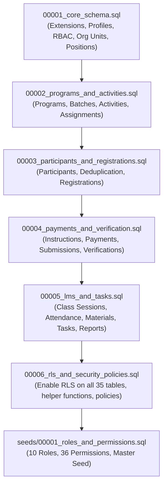

# Database Migration Plan & Sequencing
## SAPA Ayah Digital Platform
**Organization:** Yayasan Sahabat Pembelajar Ayah (SAPA) Ayah  
**Document Version:** 1.0 (Pre-Migration Architecture Plan)  
**Status:** DRAFT PLAN — MENUNGGU PERSETUJUAN (Belum Dijalankan)  
**Date:** November 2026  

---

## 1. Aturan Eksekusi Migrasi

1. **Zero Premature Execution:** Dokumen ini memetakan urutan dan isi berkas migrasi SQL yang akan dibuat, namun **TIDAK ADA MIGRASI YANG DIJALANKAN KE SUPABASE** pada tahap review ini.
2. **Idempotent & Ordered Execution:** Seluruh migrasi menggunakan nomor urut 5 digit (`00001_...` s/d `00006_...`) dengan pengamanan `IF NOT EXISTS` dan rollback checklist.
3. **Pemisahan DDL, RLS, dan Seed:**
   - DDL (pembuatan tabel, tipe data, indeks, constraint) dipisahkan dari policy RLS.
   - Seed data master (roles, permissions) dimasukkan pada tahap terkontrol setelah RLS siap.

---

## 2. Urutan Berkas Migrasi SQL (Migration Sequence)

### Rincian Cakupan Berkas Migrasi:

#### 1. `00001_core_schema.sql` (Fondasi Identitas & Struktur Organisasi)
- Ekstensi PostgreSQL: `pgcrypto`, `uuid-ossp`.
- Pembuatan fungsi audit trigger otomatis `set_updated_at()`.
- Tabel: `profiles`, `roles`, `permissions`, `role_permissions`, `user_roles`.
- Tabel: `organizational_units`, `positions`, `personnel_assignments`, `job_descriptions`.
- Tabel: `memberships`, `membership_status_history`.
- Trigger otomatis: Insert profil saat user mendaftar di `auth.users`.

#### 2. `00002_programs_and_activities.sql` (Katalog & Operasional Acara)
- Tabel: `programs`, `program_batches`.
- Tabel: `activities`, `activity_assignments`.
- Index: `slug`, `status`, `scheduled_at`.

#### 3. `00003_participants_and_registrations.sql` (Basis Data Peserta)
- Tabel: `participants` (dengan constraint unik E.164 phone & lowercase email).
- Tabel: `registrations` (dengan constraint unik `participant_id` + `batch_id`).
- Fungsi normalisasi nomor telepon dan deteksi duplikasi.

#### 4. `00004_payments_and_verification.sql` (Alur Keuangan & Bukti Transfer)
- Tabel: `payment_instructions`.
- Tabel: `payments`.
- Tabel: `payment_proof_submissions` (riwayat unggahan berulang).
- Tabel: `payment_verifications` (catatan reviewer & check constraint anti verifikasi sendiri).

#### 5. `00005_lms_and_tasks.sql` (Pembelajaran, Kinerja, & Laporan Jumat)
- Tabel: `class_sessions`, `attendance_records`, `learning_materials`, `certificates`.
- Tabel: `target_periods`, `performance_targets`, `progress_updates`.
- Tabel: `tasks`, `task_assignments`, `task_updates`.
- Tabel: `weekly_reports` (dengan constraint unik `profile_id` + `week_date`).
- Tabel: `alumni_profiles`, `community_memberships`.
- Tabel: `audit_logs` (immutable table).

#### 6. `00006_rls_and_security_policies.sql` (Pengamanan Mutlak RLS)
- Pembuatan fungsi `public.has_permission(_user_id, _permission_code)` bertipe `SECURITY DEFINER`.
- Eksekusi `ALTER TABLE ... ENABLE ROW LEVEL SECURITY;` pada seluruh 35 tabel skema public.
- Pembuatan RLS Policies sesuai spesifikasi pada `docs/final-rls-policy-design.md`.

#### 7. `seeds/00001_roles_and_permissions.sql` (Seed Data Master)
- Seed 10 Role resmi sistem.
- Seed 36 Master Permission sistem.
- Mapping `role_permissions` awal untuk `super_admin`, `ketua`, `pengurus`, `bendahara`, dll.
- Rekening transfer bank awal yayasan pada `payment_instructions`.

---

## 3. Rencana Pengujian Pasca-Migrasi (Verification Protocol)

Setelah migrasi dieksekusi (setelah ada persetujuan), protokol verifikasi berikut wajib dijalankan:
1. **Schema Integrity Test:** Memeriksa bahwa seluruh 35 tabel terdaftar di `information_schema.tables` dengan status RLS `relrowsecurity = true`.
2. **Permission Guard Test:** Menjalankan unit test SQL untuk memastikan fungsi `public.has_permission()` mengembalikan `true`/`false` secara akurat tanpa rekursi.
3. **Privilege Escalation Test:** Mencoba melakukan update `user_roles` menggunakan akun ber-role `peserta` dan memastikan database mengembalikan error `insufficient_privilege` (RLS Block).
4. **Self-Verification Prevention Test:** Memverifikasi bahwa bendahara tidak dapat menyetujui transaksi jika pendaftaran tersebut terkait dengan akun pribadinya (`ck_prevent_self_verification`).

