# Final Database Design Specification
## SAPA Ayah Digital Platform
**Organization:** Yayasan Sahabat Pembelajar Ayah (SAPA) Ayah  
**Document Version:** 2.0 (Consolidated & Production-Ready Specification)  
**Database Engine:** PostgreSQL 15+ (Supabase)  
**Date:** November 2026  

---

## 1. Arsitektur Relasi & Kamus Data Kanonikal

Rancangan database final ini menggabungkan seluruh hasil audit dan perbaikan inkonsistensi:
- Menambahkan standar kolom audit: `created_at`, `updated_at`, `created_by`, `updated_by`.
- Menambahkan standar kolom archival: `is_archived BOOLEAN NOT NULL DEFAULT false`, `archived_at TIMESTAMPTZ`, `archived_by UUID REFERENCES profiles(id)`.
- Menggunakan `UUID` v4 universal (`gen_random_uuid()`).
- Penegakan integritas referensial melalui Foreign Key eksplisit (`ON DELETE RESTRICT` untuk entitas transaksi; `ON DELETE CASCADE` untuk relasi kepemilikan mutlak).

```mermaid
erDiagram
    AUTH_USERS ||--|| PROFILES : "1:1 profile"
    PROFILES ||--o{ USER_ROLES : "assigned"
    ROLES ||--o{ USER_ROLES : "defines"
    ROLES ||--o{ ROLE_PERMISSIONS : "maps"
    PERMISSIONS ||--o{ ROLE_PERMISSIONS : "maps"

    ORGANIZATIONAL_UNITS ||--o{ POSITIONS : "contains"
    POSITIONS ||--o{ POSITIONS : "reports to"
    POSITIONS ||--o{ JOB_DESCRIPTIONS : "has"
    PROFILES ||--o{ PERSONNEL_ASSIGNMENTS : "occupies"
    POSITIONS ||--o{ PERSONNEL_ASSIGNMENTS : "held by"

    PROFILES ||--o{ MEMBERSHIPS : "holds"
    MEMBERSHIPS ||--o{ MEMBERSHIP_STATUS_HISTORY : "tracks"

    PROGRAMS ||--o{ PROGRAM_BATCHES : "offers"
    PROGRAM_BATCHES ||--o{ ACTIVITIES : "includes"
    ACTIVITIES ||--o{ ACTIVITY_ASSIGNMENTS : "manned by"
    PROFILES ||--o{ ACTIVITY_ASSIGNMENTS : "assigned to"

    PROFILES ||--o| PARTICIPANTS : "linked to"
    PARTICIPANTS ||--o{ REGISTRATIONS : "submits"
    PROGRAM_BATCHES ||--o{ REGISTRATIONS : "enrolled in"

    REGISTRATIONS ||--o{ PAYMENTS : "billed through"
    PAYMENT_INSTRUCTIONS ||--o{ PAYMENTS : "instructs"
    PAYMENTS ||--o{ PAYMENT_PROOF_SUBMISSIONS : "proof attempts"
    PAYMENT_PROOF_SUBMISSIONS ||--o{ PAYMENT_VERIFICATIONS : "reviewed in"
    PROFILES ||--o{ PAYMENT_VERIFICATIONS : "reviewer"

    PROGRAM_BATCHES ||--o{ CLASS_SESSIONS : "schedules"
    PROFILES ||--o{ CLASS_SESSIONS : "facilitator"
    CLASS_SESSIONS ||--o{ ATTENDANCE_RECORDS : "records"
    PARTICIPANTS ||--o{ ATTENDANCE_RECORDS : "attends"

    PROGRAM_BATCHES ||--o{ LEARNING_MATERIALS : "provides"
    PROFILES ||--o{ LEARNING_MATERIALS : "uploaded by"

    PROGRAM_BATCHES ||--o{ CERTIFICATES : "generates"
    PARTICIPANTS ||--o{ CERTIFICATES : "awarded to"
    PROFILES ||--o{ CERTIFICATES : "signed by"

    TARGET_PERIODS ||--o{ PERFORMANCE_TARGETS : "spans"
    POSITIONS ||--o{ PERFORMANCE_TARGETS : "targets position"
    PROFILES ||--o{ PERFORMANCE_TARGETS : "targets profile"
    PERFORMANCE_TARGETS ||--o{ PROGRESS_UPDATES : "logs"
    PROFILES ||--o{ PROGRESS_UPDATES : "author"

    PERFORMANCE_TARGETS ||--o{ TASKS : "derived from"
    TASKS ||--o{ TASK_ASSIGNMENTS : "assigned to"
    PROFILES ||--o{ TASK_ASSIGNMENTS : "assignee"
    TASKS ||--o{ TASK_UPDATES : "logs progress"
    PROFILES ||--o{ TASK_UPDATES : "updater"

    PROFILES ||--o{ WEEKLY_REPORTS : "submits"

    PARTICIPANTS ||--o| ALUMNI_PROFILES : "graduates to"
    ALUMNI_PROFILES ||--o{ COMMUNITY_MEMBERSHIPS : "joins"

    PROFILES ||--o{ AUDIT_LOGS : "triggered by"
```

---

## 2. Definisi Skema Tabel Kanonikal (35 Tabel Terintegrasi)

### 2.1 Identitas, Akun & Hak Akses (RBAC)
1. **`profiles`**:
   - `id`: UUID PRIMARY KEY REFERENCES `auth.users(id)` ON DELETE CASCADE
   - `full_name`: VARCHAR(255) NOT NULL
   - `display_name`: VARCHAR(100)
   - `phone`: VARCHAR(25) (Format internasional E.164, unik)
   - `avatar_path`: TEXT
   - `account_status`: VARCHAR(20) NOT NULL DEFAULT 'active' CHECK (`account_status` IN ('active', 'suspended', 'inactive'))
   - `created_at`, `updated_at`: TIMESTAMPTZ NOT NULL DEFAULT now()
   - `is_archived`: BOOLEAN NOT NULL DEFAULT false
   - `archived_at`: TIMESTAMPTZ
2. **`roles`**:
   - `id`: UUID PRIMARY KEY DEFAULT gen_random_uuid()
   - `code`: VARCHAR(50) UNIQUE NOT NULL (`super_admin`, `ketua`, `pengurus`, `bendahara`, `admin_peserta`, `kreator_konten`, `fasilitator`, `relawan`, `peserta`, `alumni`)
   - `name`: VARCHAR(100) NOT NULL
   - `description`: TEXT
   - `is_system_role`: BOOLEAN NOT NULL DEFAULT true
   - `created_at`: TIMESTAMPTZ NOT NULL DEFAULT now()
3. **`permissions`**:
   - `id`: UUID PRIMARY KEY DEFAULT gen_random_uuid()
   - `code`: VARCHAR(100) UNIQUE NOT NULL (Format: `<module>.<action>`)
   - `module`: VARCHAR(50) NOT NULL
   - `action`: VARCHAR(50) NOT NULL
   - `description`: TEXT
   - `created_at`: TIMESTAMPTZ NOT NULL DEFAULT now()
4. **`role_permissions`**:
   - `role_id`: UUID NOT NULL REFERENCES `roles(id)` ON DELETE CASCADE
   - `permission_id`: UUID NOT NULL REFERENCES `permissions(id)` ON DELETE CASCADE
   - PRIMARY KEY (`role_id`, `permission_id`)
5. **`user_roles`**:
   - `id`: UUID PRIMARY KEY DEFAULT gen_random_uuid()
   - `user_id`: UUID NOT NULL REFERENCES `profiles(id)` ON DELETE CASCADE
   - `role_id`: UUID NOT NULL REFERENCES `roles(id)` ON DELETE CASCADE
   - `assigned_by`: UUID REFERENCES `profiles(id)`
   - `assigned_at`: TIMESTAMPTZ NOT NULL DEFAULT now()
   - `expires_at`: TIMESTAMPTZ
   - UNIQUE (`user_id`, `role_id`)

### 2.2 Struktur Organisasi & Keanggotaan
6. **`organizational_units`**:
   - `id`: UUID PRIMARY KEY DEFAULT gen_random_uuid()
   - `name`: VARCHAR(100) NOT NULL
   - `description`: TEXT
   - `created_at`, `updated_at`: TIMESTAMPTZ NOT NULL DEFAULT now()
7. **`positions`**:
   - `id`: UUID PRIMARY KEY DEFAULT gen_random_uuid()
   - `unit_id`: UUID NOT NULL REFERENCES `organizational_units(id)` ON DELETE RESTRICT
   - `title`: VARCHAR(100) NOT NULL
   - `parent_position_id`: UUID REFERENCES `positions(id)`
   - `is_active`: BOOLEAN NOT NULL DEFAULT true
   - `created_at`, `updated_at`: TIMESTAMPTZ NOT NULL DEFAULT now()
8. **`personnel_assignments`**:
   - `id`: UUID PRIMARY KEY DEFAULT gen_random_uuid()
   - `profile_id`: UUID NOT NULL REFERENCES `profiles(id)` ON DELETE RESTRICT
   - `position_id`: UUID NOT NULL REFERENCES `positions(id)` ON DELETE RESTRICT
   - `start_date`: DATE NOT NULL
   - `end_date`: DATE
   - `assignment_status`: VARCHAR(20) NOT NULL DEFAULT 'active' CHECK (`assignment_status` IN ('active', 'completed', 'transferred'))
   - `created_at`, `updated_at`: TIMESTAMPTZ NOT NULL DEFAULT now()
9. **`job_descriptions`**:
   - `id`: UUID PRIMARY KEY DEFAULT gen_random_uuid()
   - `position_id`: UUID NOT NULL REFERENCES `positions(id)` ON DELETE CASCADE
   - `responsibility`: TEXT NOT NULL
   - `performance_indicator`: TEXT
   - `created_at`, `updated_at`: TIMESTAMPTZ NOT NULL DEFAULT now()
10. **`memberships`**:
    - `id`: UUID PRIMARY KEY DEFAULT gen_random_uuid()
    - `profile_id`: UUID NOT NULL REFERENCES `profiles(id)` ON DELETE CASCADE
    - `membership_number`: VARCHAR(50) UNIQUE
    - `type`: VARCHAR(30) NOT NULL DEFAULT 'regular' CHECK (`type` IN ('candidate', 'regular', 'honorary', 'inactive'))
    - `joined_date`: DATE NOT NULL DEFAULT CURRENT_DATE
    - `created_at`, `updated_at`: TIMESTAMPTZ NOT NULL DEFAULT now()
    - `is_archived`: BOOLEAN NOT NULL DEFAULT false
    - `archived_at`: TIMESTAMPTZ
11. **`membership_status_history`**:
    - `id`: UUID PRIMARY KEY DEFAULT gen_random_uuid()
    - `membership_id`: UUID NOT NULL REFERENCES `memberships(id)` ON DELETE CASCADE
    - `previous_status`: VARCHAR(30)
    - `new_status`: VARCHAR(30) NOT NULL
    - `reason`: TEXT
    - `changed_by`: UUID REFERENCES `profiles(id)`
    - `created_at`: TIMESTAMPTZ NOT NULL DEFAULT now()

### 2.3 Program, Batch & Penugasan Pelaksana Bergilir
12. **`programs`**:
    - `id`: UUID PRIMARY KEY DEFAULT gen_random_uuid()
    - `name`: VARCHAR(150) NOT NULL
    - `slug`: VARCHAR(150) UNIQUE NOT NULL
    - `tagline`: VARCHAR(255)
    - `description`: TEXT
    - `program_type`: VARCHAR(50) NOT NULL CHECK (`program_type` IN ('journey', 'class', 'webinar', 'camp', 'talk', 'stories'))
    - `visibility`: VARCHAR(20) NOT NULL DEFAULT 'draft' CHECK (`visibility` IN ('draft', 'published', 'archived'))
    - `created_at`, `updated_at`: TIMESTAMPTZ NOT NULL DEFAULT now()
    - `is_archived`: BOOLEAN NOT NULL DEFAULT false
    - `archived_at`: TIMESTAMPTZ
13. **`program_batches`**:
    - `id`: UUID PRIMARY KEY DEFAULT gen_random_uuid()
    - `program_id`: UUID NOT NULL REFERENCES `programs(id)` ON DELETE RESTRICT
    - `batch_number`: INT NOT NULL
    - `name`: VARCHAR(150) NOT NULL
    - `slug`: VARCHAR(150) UNIQUE NOT NULL
    - `registration_open_at`: TIMESTAMPTZ NOT NULL
    - `registration_close_at`: TIMESTAMPTZ NOT NULL
    - `start_at`: TIMESTAMPTZ NOT NULL
    - `end_at`: TIMESTAMPTZ NOT NULL
    - `price`: DECIMAL(12, 2) NOT NULL DEFAULT 0.00
    - `capacity`: INT NOT NULL DEFAULT 50
    - `status`: VARCHAR(20) NOT NULL DEFAULT 'draft' CHECK (`status` IN ('draft', 'open', 'in_progress', 'completed', 'cancelled'))
    - `created_at`, `updated_at`: TIMESTAMPTZ NOT NULL DEFAULT now()
    - `is_archived`: BOOLEAN NOT NULL DEFAULT false
    - `archived_at`: TIMESTAMPTZ
14. **`activities`**:
    - `id`: UUID PRIMARY KEY DEFAULT gen_random_uuid()
    - `batch_id`: UUID REFERENCES `program_batches(id)` ON DELETE CASCADE
    - `title`: VARCHAR(200) NOT NULL
    - `description`: TEXT
    - `activity_type`: VARCHAR(50) NOT NULL CHECK (`activity_type` IN ('webinar', 'class_session', 'recording', 'meeting', 'workshop'))
    - `scheduled_at`: TIMESTAMPTZ NOT NULL
    - `location_or_url`: TEXT
    - `created_at`, `updated_at`: TIMESTAMPTZ NOT NULL DEFAULT now()
15. **`activity_assignments`**:
    - `id`: UUID PRIMARY KEY DEFAULT gen_random_uuid()
    - `activity_id`: UUID NOT NULL REFERENCES `activities(id)` ON DELETE CASCADE
    - `profile_id`: UUID NOT NULL REFERENCES `profiles(id)` ON DELETE RESTRICT
    - `role_in_activity`: VARCHAR(50) NOT NULL CHECK (`role_in_activity` IN ('pic', 'moderator', 'speaker', 'admin_support', 'content_creator', 'logistics'))
    - `notes`: TEXT
    - `assigned_by`: UUID REFERENCES `profiles(id)`
    - `assigned_at`: TIMESTAMPTZ NOT NULL DEFAULT now()
    - UNIQUE (`activity_id`, `profile_id`, `role_in_activity`)

### 2.4 Pendaftaran & Peserta (Deduplikasi)
16. **`participants`**:
    - `id`: UUID PRIMARY KEY DEFAULT gen_random_uuid()
    - `profile_id`: UUID REFERENCES `profiles(id)` ON DELETE SET NULL
    - `full_name`: VARCHAR(255) NOT NULL
    - `normalized_name`: VARCHAR(255) NOT NULL
    - `email`: VARCHAR(255) UNIQUE NOT NULL
    - `phone`: VARCHAR(25) UNIQUE NOT NULL (Format E.164, misal `+62812...`)
    - `city`: VARCHAR(100)
    - `marital_status`: VARCHAR(50) CHECK (`marital_status` IN ('married_with_children', 'married_no_children', 'engaged', 'single'))
    - `number_of_children`: INT DEFAULT 0
    - `created_at`, `updated_at`: TIMESTAMPTZ NOT NULL DEFAULT now()
    - `is_archived`: BOOLEAN NOT NULL DEFAULT false
    - `archived_at`: TIMESTAMPTZ
17. **`registrations`**:
    - `id`: UUID PRIMARY KEY DEFAULT gen_random_uuid()
    - `participant_id`: UUID NOT NULL REFERENCES `participants(id)` ON DELETE RESTRICT
    - `batch_id`: UUID NOT NULL REFERENCES `program_batches(id)` ON DELETE RESTRICT
    - `registration_source`: VARCHAR(50) NOT NULL DEFAULT 'web_self_service' CHECK (`registration_source` IN ('web_self_service', 'admin_manual', 'whatsapp_offline'))
    - `status`: VARCHAR(20) NOT NULL DEFAULT 'submitted' CHECK (`status` IN ('draft', 'submitted', 'under_review', 'accepted', 'waitlisted', 'cancelled'))
    - `notes`: TEXT
    - `submitted_at`: TIMESTAMPTZ NOT NULL DEFAULT now()
    - `reviewed_by`: UUID REFERENCES `profiles(id)`
    - `created_at`, `updated_at`: TIMESTAMPTZ NOT NULL DEFAULT now()
    - UNIQUE (`participant_id`, `batch_id`)

### 2.5 Pembayaran Transfer Manual & Histori Verifikasi
18. **`payment_instructions`**:
    - `id`: UUID PRIMARY KEY DEFAULT gen_random_uuid()
    - `bank_name`: VARCHAR(50) NOT NULL
    - `account_number`: VARCHAR(50) NOT NULL
    - `account_holder`: VARCHAR(150) NOT NULL
    - `instructions`: TEXT
    - `is_active`: BOOLEAN NOT NULL DEFAULT true
    - `created_at`, `updated_at`: TIMESTAMPTZ NOT NULL DEFAULT now()
19. **`payments`**:
    - `id`: UUID PRIMARY KEY DEFAULT gen_random_uuid()
    - `registration_id`: UUID NOT NULL REFERENCES `registrations(id)` ON DELETE RESTRICT
    - `instruction_id`: UUID NOT NULL REFERENCES `payment_instructions(id)` ON DELETE RESTRICT
    - `amount_due`: DECIMAL(12, 2) NOT NULL
    - `unique_code`: INT NOT NULL DEFAULT 0
    - `status`: VARCHAR(20) NOT NULL DEFAULT 'pending' CHECK (`status` IN ('pending', 'submitted', 'under_review', 'verified', 'rejected'))
    - `created_at`, `updated_at`: TIMESTAMPTZ NOT NULL DEFAULT now()
20. **`payment_proof_submissions`**:
    - `id`: UUID PRIMARY KEY DEFAULT gen_random_uuid()
    - `payment_id`: UUID NOT NULL REFERENCES `payments(id)` ON DELETE CASCADE
    - `submission_number`: INT NOT NULL DEFAULT 1
    - `proof_storage_path`: TEXT NOT NULL
    - `amount_transferred`: DECIMAL(12, 2) NOT NULL
    - `sender_bank_name`: VARCHAR(50)
    - `sender_account_name`: VARCHAR(150)
    - `submitted_at`: TIMESTAMPTZ NOT NULL DEFAULT now()
    - `status`: VARCHAR(20) NOT NULL DEFAULT 'submitted' CHECK (`status` IN ('submitted', 'under_review', 'verified', 'rejected'))
21. **`payment_verifications`**:
    - `id`: UUID PRIMARY KEY DEFAULT gen_random_uuid()
    - `submission_id`: UUID NOT NULL REFERENCES `payment_proof_submissions(id)` ON DELETE CASCADE
    - `reviewer_id`: UUID NOT NULL REFERENCES `profiles(id)` ON DELETE RESTRICT
    - `decision`: VARCHAR(20) NOT NULL CHECK (`decision` IN ('verified', 'rejected'))
    - `notes`: TEXT NOT NULL
    - `decided_at`: TIMESTAMPTZ NOT NULL DEFAULT now()
    - CONSTRAINT `ck_prevent_self_verification` CHECK (`reviewer_id` != (
        SELECT p.profile_id FROM participants p 
        JOIN registrations r ON r.participant_id = p.id 
        JOIN payments py ON py.registration_id = r.id 
        JOIN payment_proof_submissions pps ON pps.payment_id = py.id 
        WHERE pps.id = submission_id
      ))

### 2.6 Pembelajaran (LMS)
22. **`class_sessions`**:
    - `id`: UUID PRIMARY KEY DEFAULT gen_random_uuid()
    - `batch_id`: UUID NOT NULL REFERENCES `program_batches(id)` ON DELETE CASCADE
    - `session_number`: INT NOT NULL
    - `title`: VARCHAR(200) NOT NULL
    - `description`: TEXT
    - `starts_at`: TIMESTAMPTZ NOT NULL
    - `ends_at`: TIMESTAMPTZ NOT NULL
    - `meeting_url`: TEXT
    - `facilitator_id`: UUID REFERENCES `profiles(id)` ON DELETE SET NULL
    - `status`: VARCHAR(20) NOT NULL DEFAULT 'scheduled' CHECK (`status` IN ('scheduled', 'in_progress', 'completed', 'cancelled'))
    - `created_at`, `updated_at`: TIMESTAMPTZ NOT NULL DEFAULT now()
23. **`attendance_records`**:
    - `id`: UUID PRIMARY KEY DEFAULT gen_random_uuid()
    - `session_id`: UUID NOT NULL REFERENCES `class_sessions(id)` ON DELETE CASCADE
    - `participant_id`: UUID NOT NULL REFERENCES `participants(id)` ON DELETE CASCADE
    - `attendance_status`: VARCHAR(20) NOT NULL DEFAULT 'absent' CHECK (`attendance_status` IN ('present', 'absent', 'excused', 'late'))
    - `recorded_by`: UUID REFERENCES `profiles(id)`
    - `recorded_at`: TIMESTAMPTZ NOT NULL DEFAULT now()
    - `notes`: TEXT
    - UNIQUE (`session_id`, `participant_id`)
24. **`learning_materials`**:
    - `id`: UUID PRIMARY KEY DEFAULT gen_random_uuid()
    - `batch_id`: UUID NOT NULL REFERENCES `program_batches(id)` ON DELETE CASCADE
    - `session_id`: UUID REFERENCES `class_sessions(id)` ON DELETE SET NULL
    - `title`: VARCHAR(200) NOT NULL
    - `description`: TEXT
    - `file_storage_path`: TEXT NOT NULL
    - `file_type`: VARCHAR(50)
    - `file_size_bytes`: BIGINT
    - `uploaded_by`: UUID REFERENCES `profiles(id)`
    - `created_at`: TIMESTAMPTZ NOT NULL DEFAULT now()
25. **`certificates`**:
    - `id`: UUID PRIMARY KEY DEFAULT gen_random_uuid()
    - `certificate_number`: VARCHAR(100) UNIQUE NOT NULL
    - `batch_id`: UUID NOT NULL REFERENCES `program_batches(id)` ON DELETE RESTRICT
    - `participant_id`: UUID NOT NULL REFERENCES `participants(id)` ON DELETE RESTRICT
    - `issued_at`: DATE NOT NULL DEFAULT CURRENT_DATE
    - `pdf_storage_path`: TEXT
    - `signed_by_profile_id`: UUID REFERENCES `profiles(id)`
    - `verification_hash`: VARCHAR(64) UNIQUE NOT NULL
    - `created_at`: TIMESTAMPTZ NOT NULL DEFAULT now()
    - UNIQUE (`batch_id`, `participant_id`)

### 2.7 Tugas, Target, Progres & Laporan Jumat
26. **`target_periods`**:
    - `id`: UUID PRIMARY KEY DEFAULT gen_random_uuid()
    - `name`: VARCHAR(100) NOT NULL
    - `start_date`: DATE NOT NULL
    - `end_date`: DATE NOT NULL
    - `status`: VARCHAR(20) NOT NULL DEFAULT 'active' CHECK (`status` IN ('active', 'review', 'closed'))
    - `created_at`: TIMESTAMPTZ NOT NULL DEFAULT now()
27. **`performance_targets`**:
    - `id`: UUID PRIMARY KEY DEFAULT gen_random_uuid()
    - `period_id`: UUID NOT NULL REFERENCES `target_periods(id)` ON DELETE CASCADE
    - `position_id`: UUID REFERENCES `positions(id)` ON DELETE SET NULL
    - `profile_id`: UUID REFERENCES `profiles(id)` ON DELETE SET NULL
    - `title`: VARCHAR(255) NOT NULL
    - `target_metric`: VARCHAR(100) NOT NULL
    - `target_value`: INT NOT NULL
    - `achieved_value`: INT NOT NULL DEFAULT 0
    - `created_at`, `updated_at`: TIMESTAMPTZ NOT NULL DEFAULT now()
28. **`progress_updates`**:
    - `id`: UUID PRIMARY KEY DEFAULT gen_random_uuid()
    - `target_id`: UUID NOT NULL REFERENCES `performance_targets(id)` ON DELETE CASCADE
    - `updated_by`: UUID NOT NULL REFERENCES `profiles(id)` ON DELETE RESTRICT
    - `increment_value`: INT NOT NULL DEFAULT 0
    - `notes`: TEXT NOT NULL
    - `evidence_url`: TEXT
    - `created_at`: TIMESTAMPTZ NOT NULL DEFAULT now()
29. **`tasks`**:
    - `id`: UUID PRIMARY KEY DEFAULT gen_random_uuid()
    - `related_target_id`: UUID REFERENCES `performance_targets(id)` ON DELETE SET NULL
    - `title`: VARCHAR(255) NOT NULL
    - `description`: TEXT
    - `priority`: VARCHAR(20) NOT NULL DEFAULT 'medium' CHECK (`priority` IN ('low', 'medium', 'high', 'urgent'))
    - `status`: VARCHAR(20) NOT NULL DEFAULT 'todo' CHECK (`status` IN ('todo', 'in_progress', 'completed', 'cancelled'))
    - `due_at`: TIMESTAMPTZ
    - `created_by`: UUID REFERENCES `profiles(id)`
    - `created_at`, `updated_at`: TIMESTAMPTZ NOT NULL DEFAULT now()
    - `is_archived`: BOOLEAN NOT NULL DEFAULT false
    - `archived_at`: TIMESTAMPTZ
30. **`task_assignments`**:
    - `task_id`: UUID NOT NULL REFERENCES `tasks(id)` ON DELETE CASCADE
    - `assignee_id`: UUID NOT NULL REFERENCES `profiles(id)` ON DELETE RESTRICT
    - `assigned_by`: UUID REFERENCES `profiles(id)`
    - `assigned_at`: TIMESTAMPTZ NOT NULL DEFAULT now()
    - PRIMARY KEY (`task_id`, `assignee_id`)
31. **`task_updates`**:
    - `id`: UUID PRIMARY KEY DEFAULT gen_random_uuid()
    - `task_id`: UUID NOT NULL REFERENCES `tasks(id)` ON DELETE CASCADE
    - `logged_by`: UUID NOT NULL REFERENCES `profiles(id)` ON DELETE RESTRICT
    - `progress_percent`: INT CHECK (`progress_percent` BETWEEN 0 AND 100)
    - `notes`: TEXT NOT NULL
    - `created_at`: TIMESTAMPTZ NOT NULL DEFAULT now()
32. **`weekly_reports`** (Laporan Jumat):
    - `id`: UUID PRIMARY KEY DEFAULT gen_random_uuid()
    - `profile_id`: UUID NOT NULL REFERENCES `profiles(id)` ON DELETE RESTRICT
    - `week_date`: DATE NOT NULL
    - `completed_work`: TEXT NOT NULL
    - `upcoming_plan`: TEXT NOT NULL
    - `blockers`: TEXT NOT NULL
    - `submitted_at`: TIMESTAMPTZ NOT NULL DEFAULT now()
    - UNIQUE (`profile_id`, `week_date`)

### 2.8 Alumni, Komunitas & Audit
33. **`alumni_profiles`**:
    - `id`: UUID PRIMARY KEY DEFAULT gen_random_uuid()
    - `participant_id`: UUID UNIQUE NOT NULL REFERENCES `participants(id)` ON DELETE RESTRICT
    - `graduation_date`: DATE NOT NULL DEFAULT CURRENT_DATE
    - `is_active_community_member`: BOOLEAN NOT NULL DEFAULT true
    - `notes`: TEXT
    - `created_at`: TIMESTAMPTZ NOT NULL DEFAULT now()
34. **`community_memberships`**:
    - `id`: UUID PRIMARY KEY DEFAULT gen_random_uuid()
    - `alumni_id`: UUID NOT NULL REFERENCES `alumni_profiles(id)` ON DELETE CASCADE
    - `community_group_name`: VARCHAR(100) NOT NULL
    - `joined_at`: TIMESTAMPTZ NOT NULL DEFAULT now()
35. **`audit_logs`**:
    - `id`: UUID PRIMARY KEY DEFAULT gen_random_uuid()
    - `actor_id`: UUID REFERENCES `profiles(id)`
    - `action`: VARCHAR(100) NOT NULL
    - `entity_type`: VARCHAR(50) NOT NULL
    - `entity_id`: UUID NOT NULL
    - `before_data`: JSONB
    - `after_data`: JSONB
    - `ip_address`: VARCHAR(45)
    - `user_agent`: TEXT
    - `created_at`: TIMESTAMPTZ NOT NULL DEFAULT now()

