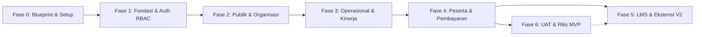

# Technical Implementation Roadmap & Release Strategy
## SAPA Ayah Digital Platform
**Organization:** Yayasan Sahabat Pembelajar Ayah (SAPA) Ayah  
**Document Version:** 1.0  
**Status:** Implementation Blueprint  
**Date:** November 2026  

---

## 1. Ikhtisar Roadmap Fase Pengembangan

Pengembangan platform digital SAPA Ayah dilakukan secara bertahap menggunakan pendekatan gerbang persetujuan (*gated release strategy*) untuk memastikan stabilitas fondasi, kepatuhan keamanan, dan keselarasan dengan kebutuhan yayasan:

---

## 2. Rincian Fase Implementasi

### Fase 0: Finalisasi Blueprint & Inisialisasi Proyek (Saat ini)
- **Tujuan:** Audit dokumentasi, penyiapan arsitektur proyek Next.js, pembuatan dokumen teknis induk, dan pemetaan seluruh risiko serta keputusan terbuka.
- **Ruang Lingkup:**
  - Audit kelengkapan Master Blueprint.
  - Setup struktur folder Next.js modular.
  - Setup konfigurasi Tailwind CSS (Brand palette SAPA Ayah).
  - Penyusunan dokumen teknis lengkap di `docs/`.
- **Gerbang Kelulusan (Gate):** Persetujuan tertulis dokumen inisialisasi dari pemilik proyek sebelum pembuatan tabel database atau fitur aplikasi.

### Fase 1: Fondasi Teknis, Supabase Auth & RBAC
- **Tujuan:** Menyiapkan backend Supabase, skema data inti akun, autentikasi aman, dan penegakan RBAC.
- **Ruang Lingkup:**
  - Migrasi Supabase: `profiles`, `roles`, `permissions`, `role_permissions`, `user_roles`.
  - Fungsi PostgreSQL `has_permission` & implementasi RLS minimum.
  - Integrasi Next.js Supabase SSR client/server utilities.
  - Autentikasi: Login, Register Peserta, Lupa Password, Logout.
  - Komponen UI dasar: AppShell, Layout Public, Dashboard Shell, Portal Shell.
- **Kriteria Keberhasilan:** Pengguna dapat login dan diarahkan ke dashboard atau portal sesuai role yang dimiliki; RLS memblokir akses tidak sah pada level database.

### Fase 2: Public Website & Manajemen Organisasi
- **Tujuan:** Menyediakan kanal informasi resmi publik dan modul pengelolaan struktur pengurus.
- **Ruang Lingkup:**
  - Halaman Publik: Beranda, Tentang Kami (Visi, Misi, Nilai Inti), Kontak Resmi.
  - Pengaturan Desain: Komponen UI konsisten, tipografi Plus Jakarta Sans / Inter, branding SAPA Ayah (#547F9F, #385A75, #E8F0F5).
  - Dashboard Organisasi: Pengelolaan unit, jabatan struktural, jobdesk, penugasan personel.
- **Kriteria Keberhasilan:** Profil yayasan dan struktur kepengurusan dapat dikelola secara dinamis via dashboard tanpa hardcode data di aplikasi.

### Fase 3: Operasional Program, Tugas & Laporan Jumat
- **Tujuan:** Mendukung ritme kerja rutin pengurus dan pemantauan target kinerja bulanan.
- **Ruang Lingkup:**
  - Katalog Program & Batch: Form pembuatan program, pengaturan kuota, tanggal, harga.
  - Manajemen Tugas (Tasks): Penugasan PIC, tenggat, prioritas, status progres.
  - Modul Laporan Jumat: Form 3 baris ("Sudah apa", "Akan apa", "Kendala").
  - Panel Rekapitulasi Humas: Monitoring status kepatuhan laporan mingguan dan fitur kompilasi.
  - Target Bulanan: Pencatatan KPI bulanan pengurus dan rekap triwulanan.
- **Kriteria Keberhasilan:** Seluruh pengurus dapat mengisi laporan mingguan Jumat dan Humas dapat menghasilkan rekapitulasi progres mingguan.

### Fase 4: Pendaftaran Peserta & Verifikasi Pembayaran Manual (MVP Completion)
- **Tujuan:** Menyelesaikan alur inti pendaftaran peserta, pembayaran transfer rekening bank, dan portal peserta mandiri.
- **Ruang Lingkup:**
  - Pendaftaran Mandiri Online (`/daftar/[batchSlug]`) & Input Manual Admin (`/dashboard/peserta`).
  - Mekanisme deduplikasi peserta berdasarkan Email & WhatsApp.
  - Penerbitan instruksi pembayaran rekening yayasan + kode transfer.
  - Upload bukti transfer ke private Supabase storage bucket (`private-payment-proofs`).
  - Panel Verifikasi Bendahara: Review bukti bayar, catatan revisi/penolakan, dan persetujuan status.
  - Portal Peserta: Dashboard status pendaftaran, status pembayaran, dan riwayat kelas.
- **Kriteria Keberhasilan:** Seluruh kriteria "Definisi MVP Selesai" terpenuhi dan siap diuji secara menyeluruh.

### Fase 5: LMS Dasar & Modul Ekstensi (Pasca-MVP / V2)
- **Tujuan:** Memperluas kapabilitas pembelajaran dan tata kelola yayasan lanjutan.
- **Ruang Lingkup:**
  - LMS: Jadwal sesi kelas, materi terlindungi via signed URL, absensi sesi oleh fasilitator, penerbitan sertifikat.
  - Modul Keuangan Yayasan: Pencatatan kas masuk/keluar, kategori biaya, laporan keuangan bulanan bendahara.
  - Modul Konten: Kalender produksi media, arsip konten video/podcast, URL publikasi.
  - Modul Komunitas: Direktori jejaring alumni program.
- **Kriteria Keberhasilan:** Peserta yang telah lulus dapat mengakses arsip materi dan sertifikat kelulusan.

### Fase 6: Security Hardening, UAT & Peluncuran Produksi
- **Tujuan:** Pengujian penetrasi keamanan, verifikasi UAT dengan pengurus, dan deployment produksi ke Vercel & Supabase Production.
- **Ruang Lingkup:**
  - Security audit: pencegahan privilege escalation, validasi upload, pengujian RLS.
  - Pengujian responsivitas mobile pada seluruh form penting.
  - User Acceptance Testing (UAT) berdasarkan 12 skenario minimum blueprint.
  - Penyiapan domain resmi dan backup database otomatis.
- **Kriteria Keberhasilan:** Persetujuan rilis resmi dari Ketua Yayasan dan tim teknis.

---

## 3. Definisi MVP Selesai (Definition of Done - MVP)

Platform dinyatakan siap rilis MVP apabila seluruh butir berikut telah terverifikasi:
1. [x] Pengunjung dapat melihat profil lengkap dan katalog program berstatus `published`.
2. [x] Peserta baru dapat mendaftarkan akun dan mendaftar pada batch program yang sedang aktif.
3. [x] Admin peserta dapat menginput pendaftaran offline/manual dengan deduplikasi kontak.
4. [x] Peserta dapat mengunggah bukti transfer manual ke storage terenkripsi/privat.
5. [x] Bendahara/Petugas verifikasi dapat memeriksa bukti dan mengubah status pembayaran dengan catatan wajib.
6. [x] Peserta dapat memantau status pendaftaran dan pembayaran di portal mandiri mereka.
7. [x] Pengurus dapat mengelola master jabatan, jobdesk, tugas kerja, dan mengirim laporan Jumat tiga baris.
8. [x] Humas dapat memantau dan menyusun rekap laporan mingguan.
9. [x] Seluruh kebijakan RLS Supabase dan validasi authorization server-side telah diuji secara komprehensif.
10. [x] Aplikasi ter-deploy secara stabil di Vercel dengan environment variables yang aman.

